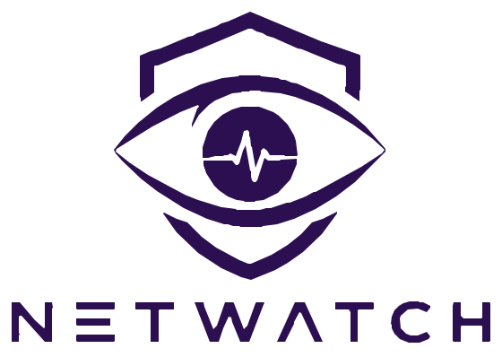
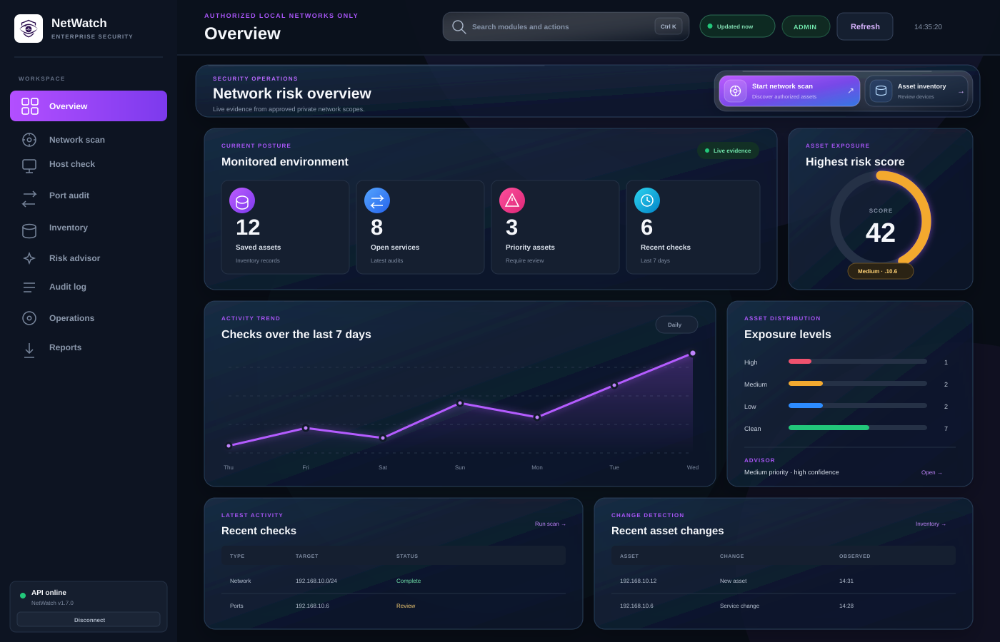
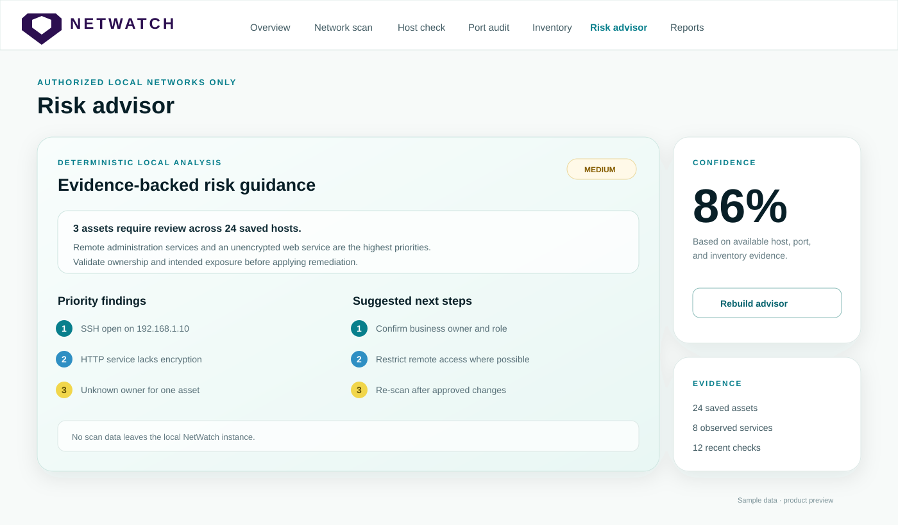
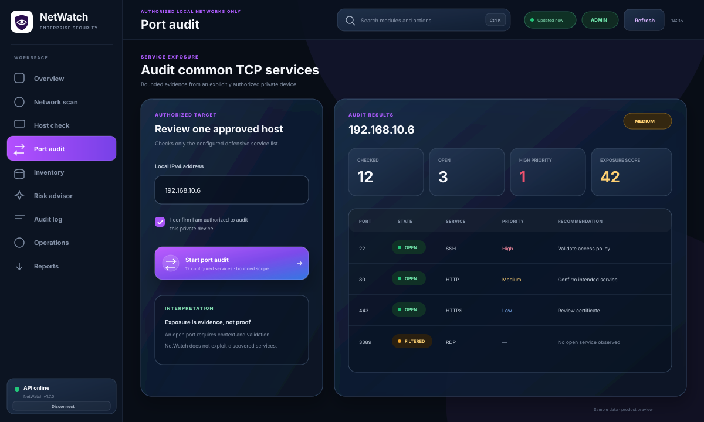

<p align="center">
  
</p>

<h1 align="center">NetWatch</h1>

<p align="center">
  <strong>Local-first network visibility for authorized environments.</strong><br>
  Discover assets. Understand changes. Investigate with evidence.
</p>

<p align="center">
  <a href="https://github.com/Adam-Ghanem/NetWatch/actions/workflows/python-ci.yml"></a>
  
  
  <a href="https://hub.xerj.org/contributors/Adam-Ghanem"></a>
</p>

> **NetWatch is a defensive tool.** Use it only on networks and devices you own or are explicitly authorized to assess.

## What is NetWatch?

NetWatch is a self-hosted network visibility platform for authorized networks.

- Asset discovery
- Device / OS intelligence
- Change detection
- Service review
- Evidence & history
- Optional AI investigation with your own API key

## Screenshots

<p align="center">
  
</p>

<p align="center"><strong>Overview</strong></p>

<table align="center">
<tr>
<td width="50%" align="center"><br><strong>Risk Advisor</strong></td>
<td width="50%" align="center"><br><strong>Port Audit</strong></td>
</tr>
</table>

## AI

Optional. Choose **OpenAI/GPT** or **Anthropic/Claude**, using your own server-side API key:

```bash
# OpenAI (default)
export NETWATCH_AI_PROVIDER="openai"
export OPENAI_API_KEY="your-openai-api-key"
export NETWATCH_AI_MODEL="gpt-5-mini"

# Or, instead of the above, select Claude:
# export NETWATCH_AI_PROVIDER="anthropic"
# export ANTHROPIC_API_KEY="your-anthropic-api-key"
# export NETWATCH_AI_MODEL="claude-sonnet-5-5"
```

Only bounded, de-identified evidence is shared. AI has no scan or remediation tools. Core monitoring works without any AI key. Opt-in automatic brief generation
is supported by setting `NETWATCH_AI_AUTO_ANALYSIS_ENABLED=true`, with a
minimum one-hour interval, durable change detection and the same safety/cost
limits. It is disabled by default. See [AI setup](docs/AI.md).

## Quick Start

```bash
git clone https://github.com/Adam-Ghanem/NetWatch.git
cd NetWatch
python scripts/start.py
```

Open `http://127.0.0.1:8000`.

## Security

The supported FastAPI dashboard uses patched Pillow 13.0.0 and does not install the older Streamlit frontend. Legacy Streamlit execution is temporarily disabled because published releases still require vulnerable Pillow < 13. See [deployment guidance](docs/deployment.md).

Authorization-first, evidence-driven, scope-controlled, and local-first. Never commit secrets or use NetWatch against systems you are not authorized to assess.

See the [2026-10-22 security/CI evidence snapshot](docs/security-audit-2026-10-22.md) for exact passing workflow SHAs, regression coverage, and the open production-security gates.

## Community recognition

The [XERJ Corpus Hub contributor profile](https://hub.xerj.org/contributors/Adam-Ghanem) lists NetWatch as **selected** for its PCAP-analysis evidence work (selected commit `e8f6d39132`, 10 October 2026). As of 22 October 2026, the listing is **in licence review**, not a live or installable corpus. See [XERJ recognition and status notes](docs/XERJ.md). This is attribution and selection, **not** an independent audit, certification, or endorsement of NetWatch's security posture.

## License

MIT — see [`LICENSE`](LICENSE).
